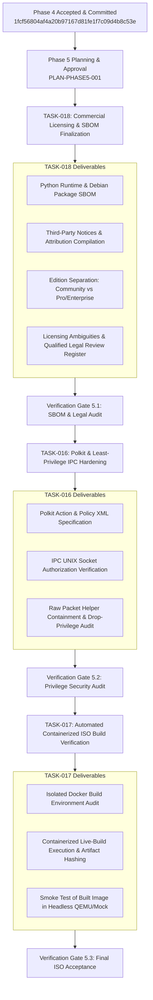

# ITSA Network OS — Phase 5 Planning, Architecture & Implementation Readiness

> **Document ID:** PLAN-PHASE5-001  
> **Status:** Active Baseline / TASK-018 Audited & Awaiting Review  
> **Phase:** Phase 5 — Release Readiness, Legal Compliance, Privilege Hardening & Distribution Verification  
> **Repository:** `/home/emorphi/Desktop/netF/itsa-network-os`  
> **Baseline Commit:** `1fcf56804af4a20b97167d81fe1f7c09d4b8c53e` (`feat: implement Phase 4 async GUI responsiveness, truthful health, and lifecycle hardening`)  
> **Last Updated:** October 29, 2026  

---

## 1. Executive Summary & Phase Objective

Phase 5 transitions ITSA Network OS from an internally stabilized desktop and CLI diagnostic toolchain to a fully documented, legally compliant, privilege-hardened, and distributable network operations platform. 

The primary objective of Phase 5 is to establish rigorous release readiness, complete Software Bill of Materials (SBOM) generation, audit all third-party license obligations, formalize Polkit least-privilege IPC boundaries, and prepare verifiable containerized packaging without compromising host safety or violating copyleft legal invariants.

### 1.1 Strict Roadmap Ordering Invariant

In strict adherence to project governance and architectural rules:
- **`TASK-018` (Commercial Licensing & SBOM Finalization) MUST PRECEED `TASK-016` (Polkit & Least-Privilege IPC Hardening).**
- **`TASK-016` MUST PRECEED `TASK-017` (Automated Containerized ISO Build Verification).**
- **`TASK-017` is the final verification stage of Milestone 5 (`MILE-05`).**
- **No ISO compilation, bootable USB generation, or release image generation shall occur during Phase 5 planning or initial compliance work.** Any ISO or USB build activity requires explicit, separate owner authorization and must take place within an isolated containerized environment.

---

## 2. Explicit Non-Goals & Safety Boundaries

### 2.1 Non-Goals
1. **No Live ISO or USB Generation:** No invocation of `live-build`, `debootstrap`, `xorriso`, or `scripts/build_live_iso.sh` during planning or compliance phases.
2. **No Privileged Host Execution:** No execution of commands requiring `sudo`, `pkexec`, or elevated root privileges on the developer host.
3. **No Active Live Probing:** No unauthenticated network scans, live ARP sweeps, packet injection, or network device login attempts.
4. **No Database Modification:** Absolute zero-touch invariant on the production database at `/home/emorphi/.config/itsa-network-os/data.sqlite3`.
5. **No Host Partition/Bootloader Interference:** Zero interaction with host storage partitions, Windows 11 BitLocker/NTFS volumes, EFI system partitions, or GRUB/systemd-boot configurations.
6. **No Unapproved Dependency Changes:** No modification of `pyproject.toml`, system Debian packages, or virtual environment dependencies without dedicated review.
7. **No Unsubstantiated Legal Conclusions:** All legal and compliance analysis represents technical inventory and licensing posture evaluation; ambiguous licensing matters (such as NPSL) are recorded for qualified legal review rather than presumed settled.

---

## 3. Detailed Scope & Task Sequence

Phase 5 organizes the remaining Milestone 5 (`MILE-05`) work into three sequential, gated tasks:



### 3.1 Task Sequence & Breakdown

| Order | Task ID | Title | Prerequisites | Status | Scope Summary |
|:---:|:---:|---|---|:---:|---|
| **1** | **`TASK-018`** | Commercial Licensing & SBOM Finalization | Phase 4 Acceptance (`1fcf568`) | **COMPLETED / AUDITED** | Complete audit of Python dependencies, Debian packages, dynamic linking boundaries, third-party notices, edition claims, and machine-readable SBOM generation. |
| **2** | **`TASK-016`** | Polkit & Least-Privilege IPC Specification | Gate 5.1 Approval (`TASK-018`) | `PLANNED (NEXT GATED TASK)` | Hardening and audit of `itsa_network_os.security.privilege` IPC server, client, Polkit authorizer (`pkcheck`), and packet capture helper containment. |
| **3** | **`TASK-017`** | Automated Containerized ISO Build Verification | Gate 5.2 Approval (`TASK-016`) | `PLANNED (FINAL)` | Isolated Docker-based build verification of Debian 13 Live ISO, checking reproducibility, image checksums, and non-destructive execution. |

---

## 4. Release Readiness & Legal/Compliance Architecture (`TASK-018`)

Before any binary or ISO packaging can be approved for distribution, the platform must satisfy rigorous legal, compliance, and supply-chain requirements.

### 4.1 Dependency and Licensing Inventory

#### A. Python Application Layer
- **Core Application (`itsa-network-os`)**: MIT License. Fully permissive for commercial distribution, sublicensing, and proprietary extensions. Zero external dependencies required for core CLI/API.
- **Python Standard Library (3.13.5)**: Python Software Foundation License (PSF 2.0). Permissive with copyright notice retention.
- **PySide6 / Shiboken6 (6.12.0)**: LGPL-3.0-only OR GPL-2.0-only OR GPL-3.0-only. Dynamically loaded via standard shared objects (`.so`) in the virtual environment. **Critical Compliance Requirement**: No static linking into C extensions. Users must be able to swap Qt dynamic libraries. Reverse engineering rights under LGPLv3 section 3/4 are respected.
- **Pytest / Pytest-Cov / Coverage / Iniconfig / Packaging / Pluggy / Pygments / Pip**: MIT / Apache-2.0 / BSD-2-Clause. Developer-only dependencies; excluded from live production runtime and ISO chroot distribution.

#### B. Debian 13 (Trixie) System Packages ([`itsa.list.chroot`](file:///home/emorphi/Desktop/netF/itsa-network-os/debian-live/config/package-lists/itsa.list.chroot))
- **Linux Kernel (`linux-image-amd64`)**: GNU GPLv2. Binary distribution requires offering corresponding source code. Debian upstream source repositories satisfy source availability when properly documented.
- **`systemd`, `systemd-sysv`**: LGPLv2.1+ / GPLv2. Standard binary distribution.
- **Networking Stack (`iproute2`, `ethtool`, `net-tools`, `traceroute`, `iptables`, `nftables`)**: GNU GPLv2 / GPLv2+. Standard Debian binary distribution.
- **Permissive Utilities (`iputils-ping`, `tcpdump`, `curl`, `sqlite3`)**: BSD-3-Clause, MIT, and Public Domain. Permissive with attribution.
- **DNS Utilities (`dnsutils` / BIND9 tools)**: Mozilla Public License 2.0 (MPL-2.0). File-level copyleft; binary redistribution permitted with MPL notice.
- **`wireshark`, `tshark`**: GNU GPLv2+. Boundary via CLI subprocess execution (`tshark -r`); no in-process C linkage.
- **`nmap`**: Nmap Public Source License (NPSL). **Compliance Note**: NPSL contains specific restrictions regarding commercial aggregation and derivative works. The platform invokes `nmap` only as an external CLI binary or passive parser, avoiding derivative work status, but this requires explicit documentation in the legal review register.
- **Desktop Environment (`xfce4`, `lightdm`)**: GPLv2+ / LGPLv2+. Standard Debian desktop binaries.

### 4.2 SBOM Generation Strategy & Reproducibility

1. **Format Standards**: Implemented machine-readable CycloneDX 1.5 JSON and SPDX 2.3 formats.
2. **Dual-Layer SBOM**:
   - *Application Layer*: Extracted from Python virtual environment metadata (`METADATA` file hashes, package hashes, license classifiers).
   - *Distribution Layer*: Extracted from verified host package copyright records and the declared Debian Live package manifest.
3. **Cryptographic Reproducibility**:
   - SHA-256 hashes generated for every application metadata file and local license text file.
   - Pinned repository snapshots for Debian package downloads.

### 4.3 Third-Party Notices and Attribution Obligations

- Compiled a consolidated `THIRD_PARTY_NOTICES.md` containing complete license texts, copyright notices, and disclaimers for all bundled components.
- Documented explicit instructions on how users may obtain upstream source code for all GPL/LGPL components redistributed on the live ISO.
- Provided dynamic linking verification instructions for PySide6 / Qt 6.

### 4.4 Debian Base-System Redistribution Considerations

- Package sources restricted strictly to official Debian repositories (`main`, `contrib`, and `non-free-firmware`).
- In Debian 12/13, proprietary hardware firmware (e.g. Intel/Broadcom/Realtek wireless drivers) is housed in `non-free-firmware`. Its inclusion is essential for hardware field technician laptops but requires clear licensing notice separation from DFSG-pure `main` packages.

### 4.5 Separation of Edition Claims & Capabilities

To preserve marketing integrity and prevent false claims, documentation and UI strings strictly distinguish between **verified working capabilities** and **planned commercial tiers**:

| Edition Tier | Licensing | Current Status | Included & Verified Capabilities |
|---|---|---|---|
| **Community Edition** | Open Source (MIT Core + LGPL GUI) | **Fully Verified & Implemented** | Full CLI diagnostic toolchain, 14-tab desktop GUI shell, non-root DNS diagnostics, TCP latency benchmarks, kernel route/bandwidth parsing, Dijkstra SPF simulator, local port auditor, client TLS inspector, educational packet lab, passive MNDP/ONVIF listeners with ScopeGuard, SQLite persistence engine, AssetGraph & AssetDetailInspector (5 facet tabs), async GUI workers, truthful health status. |
| **Professional Edition** | Commercial / Proprietary Add-on | **Planned (Milestone 3 / 4)** | Automated white-label PDF/HTML reporting, persistent multi-session topology change diffs, live 802.11 RF waterfall canvas visualizer. |
| **Enterprise Edition** | Commercial Enterprise SLA | **Planned (Milestone 5+)** | Certified hardware vendor integration packs, automated CIS/NIST compliance reporting, centralized fleet synchronization, custom driver backports. |

### 4.6 Unresolved Licensing Questions for Qualified Review

- **Issue LIC-001 (Nmap Public Source License - NPSL)**: Assess whether distributing `nmap` on the bootable ISO alongside commercial add-on software constitutes an aggregated distribution (permitted) or a derivative product (restricted under NPSL).
- **Issue LIC-002 (Non-Free Firmware Redistribution)**: Ensure all redistributed firmware packages from `non-free-firmware` grant redistribution rights for unmodified installation media.

---

## 5. Privilege Boundaries & Security Hardening (`TASK-016`)

Following legal finalization, `TASK-016` will formalize the privilege boundary architecture to ensure that low-level network operations cannot compromise host integrity.

### 5.1 Architecture & IPC Boundary
- **Privilege Separation Principle**: The GUI and CLI run strictly as an unprivileged user (`uid >= 1000`).
- **Elevated Helper Daemon**: A minimal, dedicated helper daemon (`helper_main.py`) performs restricted operations (e.g. raw socket binding for low-level packet capture).
- **Communication Channel**: Secured UNIX domain socket (`/run/itsa/privilege-helper.sock`) with restricted permissions (`0660`, group `itsa-admin`).
- **PolicyKit Integration (`PolkitAuthorizer`)**: Queries system `pkcheck` for action `org.itsa.networkos.capture`. Requests requiring authorization trigger native desktop authentication prompts without running the GUI as root.
- **Process Containment**:
  - Drops supplementary groups.
  - Applies strict BPF filter validation (`filter.py`) to prevent arbitrary packet sniffing.
  - Enforces fail-closed input bounds on interface names and packet buffers.

---

## 6. Containerized ISO Build Verification (`TASK-017`)

`TASK-017` is the final milestone verification and is held strictly behind explicit Gates 5.1 and 5.2.

### 6.1 Requirements & Constraints
- **Strictly Containerized**: Must execute inside a Docker container using Debian 13 (`debian:trixie`) as the build environment. Host system disks and loopback devices remain untouched.
- **Isolated Artifact Directory**: Build outputs (`.iso`, `.hybrid.iso`, `.sha256`) saved to `build-output/` within the project root.
- **Verification Gates**:
  1. Successful `live-build` execution without error.
  2. Generation of verifiable SHA-256 and SHA-512 checksums.
  3. Headless boot verification in QEMU (read-only, no network access, offscreen).
  4. Inspection of package manifest to ensure 100% concordance with the SBOM generated in `TASK-018`.

---

## 7. Verification Gates & Exit Criteria

```
+-----------------------------------------------------------------------------------+
| GATE 5.1: Legal, Licensing & SBOM Acceptance (TASK-018)                           |
| - Machine-readable CycloneDX/SPDX SBOM files generated & validated.               |
| - THIRD_PARTY_NOTICES.md generated with all upstream licenses & source offers.   |
| - Community vs. Pro/Enterprise claims reconciled across all docs and UI.          |
| - Licensing Evidence Register (licensing_evidence_register.json) generated.       |
| - Independent audit verdict: ACCEPT.                                              |
+-----------------------------------------------------------------------------------+
                                      |
                                      v
+-----------------------------------------------------------------------------------+
| GATE 5.2: Privilege Boundary & Polkit Verification (TASK-016)                     |
| - IPC socket protocol, authentication, and validation unit tests passing (100%).  |
| - BPF filter injection prevention verified.                                       |
| - Polkit policy XML syntax and action identifiers validated against polkit rules. |
| - Independent audit verdict: ACCEPT.                                              |
+-----------------------------------------------------------------------------------+
                                      |
                                      v
+-----------------------------------------------------------------------------------+
| GATE 5.3: Containerized ISO Build & Final Milestone Acceptance (TASK-017)         |
| - Containerized build executes cleanly in isolated Docker container.              |
| - Generated ISO boots successfully in headless QEMU test harness.                 |
| - Final Phase 5 Independent Audit & Owner Acceptance.                             |
+-----------------------------------------------------------------------------------+
```

---

## 8. Status & Next Task Awaiting Owner Approval

### Current Status
`TASK-018: Commercial Licensing & SBOM Finalization` deliverables have been generated and validated:
- `THIRD_PARTY_NOTICES.md`
- `sbom.spdx.json` (SPDX 2.3)
- `sbom.cdx.json` (CycloneDX 1.5)
- `licensing_evidence_register.json`
- `phase5_planning.md` (reconciled task sequence: `TASK-018` -> `TASK-016` -> `TASK-017`)

### Next Task Awaiting Owner Authorization (Upon Gate 5.1 Approval)
> **`TASK-016`: Polkit & Least-Privilege IPC Specification / Hardening**  
> *(Hardening and independent audit of Polkit policy XML, UNIX domain socket authorization, and packet capture helper containment).*
